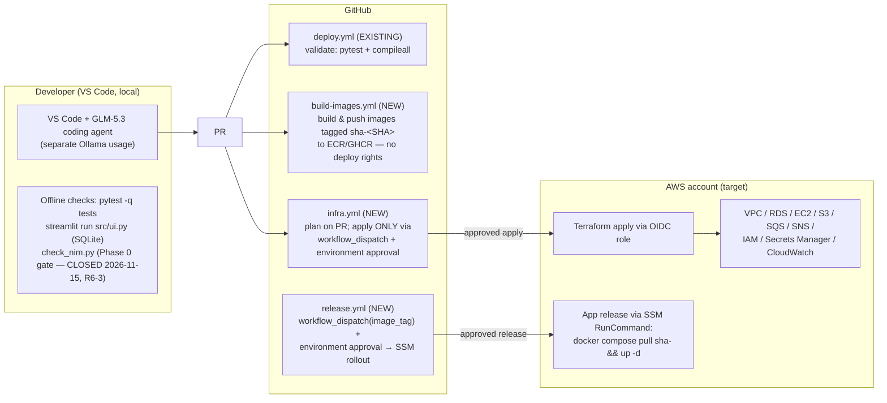
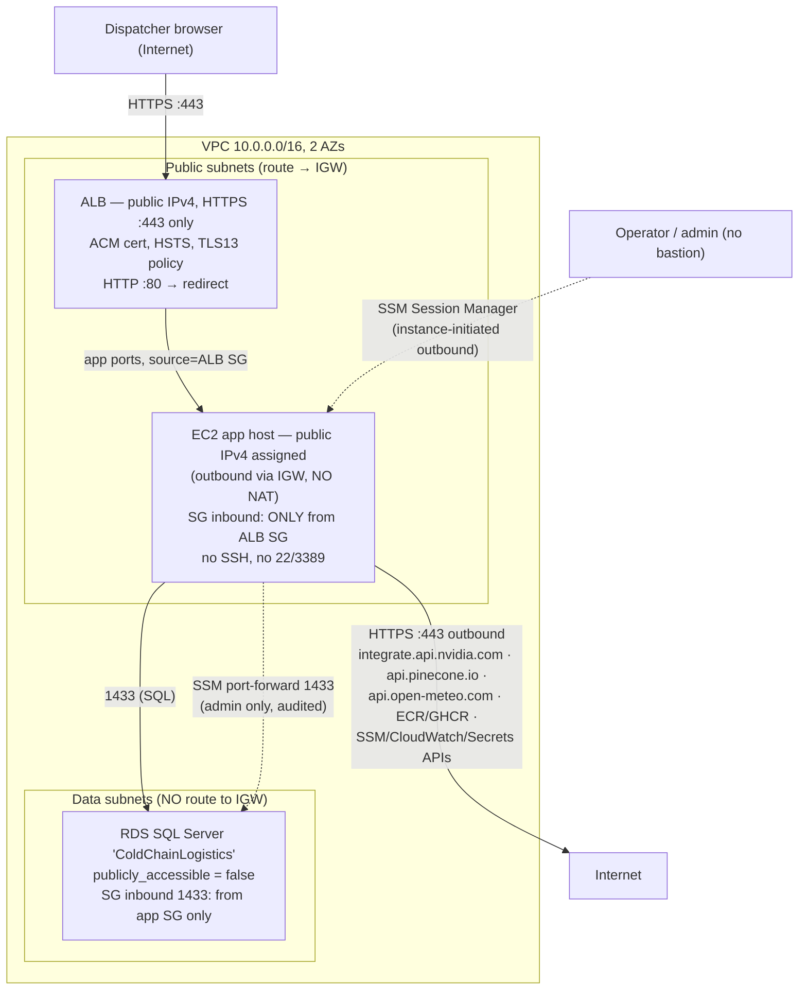
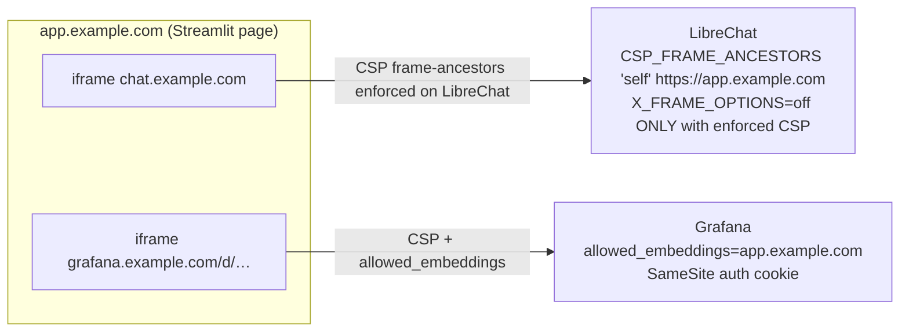

# 01 — AWS Architecture Blueprint (VS Code → GitHub Actions → AWS)

Revision 5 (2026-11-03: `authenticate-cognito` terminology standardized for
the Streamlit gate — R5-3. Prior corrections remain in effect: Cognito
client-secret R4-1, operator authorization posture R4-2, host-before-import
R3-1, exact SG/route rules R3-4, capacity budget as a load-test candidate
R4-4, C1–C15, R3-1–R3-10).
Status: DESIGN FOR AUDIT. Not implemented. `docs/ARCHITECTURE_AUDIT.md`
confirms today's reality: "No Terraform AWS stack or deploy-to-AWS CI
workflow is included. Existing GitHub workflow is validation only." Verified
by code search: zero Terraform files in the repository.

> **Revision 6 amendment (2026-11-08, operator decision R6-1; model
> amendment 2026-11-14, ledger R6-2):** the application's runtime LLM is
> **NVIDIA NIM** (`https://integrate.api.nvidia.com/v1`, production model
> `z-ai/glm-5.3-flash`) — the only supported provider, replacing the Ollama
> Cloud design this document originally described. Where this document says
> "Ollama Cloud", `ollama.com`, or `OLLAMA_API_KEY`, read NVIDIA NIM /
> `integrate.api.nvidia.com` / `NVIDIA_API_KEY` per R6-1/R6-2; runtime design
> details live in `docs/NVIDIA_NIM_RUNTIME.md` (02 is preserved as the
> superseded Ollama design with its own banner). **Phase 0 C13 live gate:
> CLOSED 2026-11-15 (ledger R6-3).** All other architecture decisions stand.

## 1. Target workflow (four separated pipelines — correction C6)



Separation rules (correction C6):

1. **Validate** (`.github/workflows/deploy.yml`, exists) — pytest + compileall
   on PR/push. Unchanged.
2. **Build** (`build-images.yml`, new) — builds the three application images
   (gateway+agent, streamlit UI, worker) and pushes `sha-<commit>` tags.
   Has zero AWS deployment permissions (push-only role on the registry).
3. **Infrastructure** (`infra.yml`, new) — `terraform plan` posted on PR;
   `terraform apply` only through `workflow_dispatch` with GitHub
   Environment `infra-approval` (required reviewers). Infrastructure
   changes never deploy application images and vice versa.
4. **Release** (`release.yml`, new) — `workflow_dispatch` with `image_tag`
   input, Environment `release-approval`; rolls containers on the existing
   EC2 host via SSM RunCommand (`docker compose pull` + `up -d`). Rollback =
   re-run with the previous `sha-<tag>` (see §8 rollback doctrine).

- **OIDC, not keys**: GitHub Actions assumes IAM roles via OIDC federation.
  No `AWS_ACCESS_KEY_ID` ever enters the repository, variables, or Secrets
  Manager.
- **GitHub-hosted runners never touch private resources** (correction C7).
  Plan/apply operate only on the public AWS control plane (APIs). Anything
  inside the VPC (RDS import, grants, admin SQL) is executed **on the EC2
  host via SSM RunCommand**, which reaches out to AWS APIs itself.

## 2. Terraform state (correction C2)

```hcl
terraform {
  backend "s3" {
    bucket         = "cc-tfstate-<accountid>"   # versioning + SSE enforced
    key            = "env/dev/terraform.tfstate" # separate key per environment
    region         = "us-east-1"
    use_lockfile   = true                        # S3 NATIVE lockfile — DynamoDB is deprecated
    encrypt        = true
  }
}
```

- **No DynamoDB lock table.** S3 native state locking (`use_lockfile = true`)
  replaced it in Terraform 1.10+ and is the current documented default path;
  DynamoDB-based locking is deprecated per HashiCorp's S3 backend docs.
  Requires the deployment runner to use Terraform ≥ 1.10 — pinned in the
  workflow's setup step.
- **Versioning** enabled on the state bucket (recoverability for
  break-glass state restoration only — not a routine rollback method).
- **Encryption**: SSE-KMS with a dedicated CMK; state contains sensitive
  values wherever possible avoided by design (correction C8, §5).
- **Separation**: separate state keys (`env/dev`, `env/prod`) and IAM
  boundary policies so the dev apply role cannot read/write prod state
  objects and vice versa. Separate buckets if environments move to
  different accounts later.
- **IAM restrictions**: state-object access limited to the two OIDC deploy
  roles; no human user has `s3:PutObject` on state paths.

## 3. Network architecture — ONE chosen design (correction C1)

**Chosen test-environment design: "SG-isolated public-edge app tier + fully
private data tier".** No NAT gateway, no VPC endpoints required in the
initial tier. This resolves the earlier contradiction (the previous revision
described the EC2 host both as private-subnet/no-public-IP and as
public-subnet) by selecting exactly one topology and cost profile:



Design rules:

- **Inbound to the app host: only from the ALB security group** on the
  container ports (8501/3000/3080/8000, all looped through the ALB —
  section §7). Nothing else; no SSH key pair is created. The public IPv4
  address exists solely so the instance can initiate outbound HTTPS through
  the Internet Gateway without a NAT gateway (~$35–45/mo + data processing
  avoided) — an explicit test-environment tradeoff, documented in
  `07_AWS_COST_ESTIMATE.md`.
- **RDS is invisible to the internet**: private data subnets with no IGW
  route, `publicly_accessible = false`, SG source = app instance SG only.
  Port 1433 is never published. This satisfies TDD §4.2 with SG enforcement
  instead of a public IP.
- **Admin/import access**: SSM Session Manager port-forwarding from an
  operator session on the app host (correction C7). GitHub-hosted runners
  cannot and do not connect to RDS directly.
- **Alternative posture (documented, not chosen now)**: move the app host to
  private subnets + NAT gateway + interface endpoints (SSM, Secrets
  Manager, ECR) — stronger isolation, ~+$40–60/mo. Revisit when the
  environment stops being a demo. The Terraform module layout (§4) supports
  the swap without application changes.

### 3.1 Exact security-group and route requirements (correction R3-4)

A public IPv4 address is **not** public reachability: security groups are
stateful and default-deny inbound. The exact rule set (asserted by Terraform
tests and an external port scan at Phase 2/3 acceptance):

| Group | Inbound | Outbound |
|---|---|---|
| `sg-alb` | TCP **443 from 0.0.0.0/0**; TCP **80 from 0.0.0.0/0** (redirect only) | TCP 8501/3000/3080/8000 → `sg-app` |
| `sg-app` (EC2 host) | **ONLY** TCP 8501/3000/3080/8000 **from `sg-alb`** — no SSH rule exists at all; no other inbound of any kind | TCP **443 + 80 to 0.0.0.0/0** (NVIDIA NIM, Pinecone, Open-Meteo, registries, apt, AWS APIs via IGW); TCP **1433 → `sg-db`** |
| `sg-db` (RDS) | **ONLY** TCP **1433 from `sg-app`** | none required (stateful return) |

| Route table | Routes |
|---|---|
| Public subnets (ALB + app host) | `10.0.0.0/16 → local`; `0.0.0.0/0 → IGW` |
| Data subnets (RDS) | `10.0.0.0/16 → local` **only** — no internet route, `publicly_accessible = false` |

Phase 1 acceptance therefore reads correctly: **no EC2 instance exists in
Phase 1**; the host is provisioned in Phase 2 with the `sg-app` rules above
and an *empty* effective inbound surface (SSM is outbound-initiated) until
the ALB exists in Phase 3. Acceptance gates: (a)
`describe-security-groups` matches the table exactly; (b) an external
port-scan of the host's public IPv4 shows **zero open ports** (Phase 2) and
only the ALB's 443/80 (Phase 3).

## 4. Terraform module layout (proposed file tree)

```
infra/
├── backend.hcl.example          # S3 backend, use_lockfile=true (§2)
├── environments/
│   ├── dev/main.tf, dev.tfvars   # Express-tier RDS (cost doc)
│   └── prod/main.tf, prod.tfvars  # Standard-tier RDS
└── modules/
    ├── network/      # VPC, 2 public + 2 data subnets, IGW, SGs (§3), no NAT initially
    ├── rds/          # SQL Server instance, KMS, gp3 storage, final snapshot on destroy
    ├── sql-init/     # SSM RunCommand executions ON the EC2 host (C7) applying:
    │                 #   data/unified/sql_server_schema.sql
    │                 #   scripts/setup_unified_views.sql
    │                 #   scripts/setup_telemetry.sql
    │                 #   + executed (not commented) GRANTs + permission-verify query
    ├── data-import/  # SSM RunCommand: scripts/import_unified.py on the host,
    │                 #   admin creds fetched from Secrets Manager at runtime
    ├── compute/      # EC2 host + IAM instance profile + EBS + SSM agent +
    │                 #   Docker — HOST PROVISIONED IN PHASE 2, before any
    │                 #   import (R3-1); containers added in Phase 3
    ├── queue/        # SQS + DLQ (redrive maxReceiveCount=5), SNS topic, alarms
    ├── storage/      # S3 telemetry archive bucket (SSE, versioning)
    ├── secrets/      # Secret CONTAINERS only — values seeded out-of-band (C8, §5)
    ├── observability/# Per-phase alarms (R3-8) + consolidated dashboards (Phase 7)
    ├── alb/          # HTTPS listener, ACM cert, host routing, ALB-Cognito auth (§7)
    ├── cognito/      # Operator user pool + client + domain for ALB auth (§7.1a)
    └── oidc/         # GitHub OIDC provider + 4 separated roles (§1)
```

Everything under `infra/` is NEW. The existing `scripts/*.sql` and
`data/unified/*.sql` are consumed unmodified by `modules/sql-init` and
`modules/data-import` — the canonical dataset and view definitions are NOT
rewritten in Terraform.

## 5. Secrets at runtime (correction C8)

Design rules — secret VALUES must never appear in: EC2 user data,
Terraform state, container image layers, SSM command output, or logs:

1. **Terraform creates only empty secret containers** (metadata + tags).
   Values are seeded out-of-band by an operator
   (`aws secretsmanager put-secret-value` from an admin machine) — so no
   *application* secret value ever traverses Terraform state.
   `PINECONE_API_KEY` and `NVIDIA_API_KEY` in particular are
   external-provider secrets with no rotation support inside AWS; treating
   them as opaque operator-seeded blobs keeps them out of state entirely.
   **Documented exception (R4-1): the Cognito app-client secret
   (`generate_secret = true`) is generated by AWS and therefore resides in
   Cognito and Terraform state — its protections are specified in §7.1a
   (SSE-KMS state, apply-role-only state IAM, `sensitive`, no-leak grep,
   rotation runbook).**
2. **EC2 user data** installs only SSM agent, Docker, and pulls the
   compose file — zero credentials. It runs at boot once and is retained
   only because user data is not secret-bearing by construction.
3. **Runtime injection**: an entrypoint helper on the host (systemd timer
   or container entrypoint) calls `aws secretsmanager get-secret-value`
   through the **instance profile** (read-only IAM on the exact secret
   ARNs), writes each value to a tmpfs file (mode 0600, never to disk
   volumes), and generates the compose `.env` in `/run/coldchain/`
   (tmpfs). Containers read them at start. Files are wiped on reboot;
   `docker compose` never receives secrets as build args, so nothing lands
   in image layers.
4. **SQL passwords** (USR_FDE_RO / USR_COLDCHAIN_UI_RO / USR_GRAFANA_RO /
   USR_INCIDENT_WRITER) are generated by the seeding step, stored in
   Secrets Manager, and rotated via the DBA runbook (RDS-managed master
   credential rotation covers only the master user).
5. **Logs**: application log lines pass a scrub filter that drops
   `Authorization`, `PWD=`, and secret-shaped values before CloudWatch.
   SSM RunCommand documents mark output documents as sensitive; import
   logs redact connection strings.
6. **Verification**: a post-deploy check greps instance metadata, image
   layers (`docker history`), and CloudWatch logs for each secret's exact
   value; any hit fails the smoke gate. (Design now, executable in
   Phase 3 acceptance — currently UNVERIFIED.)

## 6. IAM design (least privilege)

| Principal | Permissions | Explicitly denied/absent |
|---|---|---|
| OIDC build role | push images to ECR/GHCR only | no AWS deploy, no state access |
| OIDC infra-plan role | terraform `plan` read set + state-object READ | no apply, no `s3:PutObject` on state |
| OIDC infra-apply role | tagged-resource write within the env scope | no IAM user creation, no billing |
| OIDC release role | `ssm:SendCommand` on the app instance (document filter), `secretsmanager:ListSecrets` for existence checks | no `GetSecretValue`, no infra write |
| EC2 instance profile | `secretsmanager:GetSecretValue` on named ARNs; `sqs:Receive/Delete` on the one queue + DLQ read; `s3:PutObject` on `synthetic/` prefix only; `sns:Publish` on the one topic; CW Logs/Metrics | no `secretsmanager:*` wildcard; no S3 delete; no queue creation |
| RDS SQL users | per `05_SECURITY_MODEL.md` §3 — views-only grants from day one | no base-table grants to any application identity |

## 7. Web access architecture (correction C15)

### 7.1 Hostnames, TLS, and ALB routing

One public zone, subdomains per service, one ACM certificate with SANs
(`app.example.com`, `chat.example.com`, `grafana.example.com`) — keeping
all browser-reachable services under **one registrable domain** is a hard
requirement (§7.3 cookies). `api` (gateway) is **not** publicly routed by
default: LibreChat reaches it over the local compose network via
`FDE_GATEWAY_URL=http://fde-api:8000/v1` (matches
`integrations/librechat/.env.example`); external gateway verification uses
SSM port-forwarding.

| Host | ALB target | Listener rule | Auth |
|---|---|---|---|
| `app.example.com` | Streamlit :8501 | host-header + ALB **authenticate-cognito** | Cognito at the ALB (Streamlit itself has no auth) |
| `chat.example.com` | LibreChat :3080 | host-header | LibreChat's own login (OIDC optional later) |
| `grafana.example.com` | Grafana :3000 | host-header | Grafana's own login |
| (none public) | FastAPI :8000 | — compose-network only | bearer `FDE_API_KEY` server-to-server |

- ALB: HTTPS :443 only with `ELBSecurityPolicy-TLS13-1-2-2021-06`; :80 →
  301 redirect; HSTS emitted at the ALB; ACM cert auto-renews.
- Backend security group accepts only the ALB SG (§3.1).

### 7.1a ALB authentication identity provider (R3-5, corrected R4-1/R4-2): Amazon Cognito

The ALB's `authenticate-cognito` action needs a concrete, configured IdP.
The blueprint selects **Amazon Cognito user pool** for the test environment:

| Item | Configuration |
|---|---|
| User pool | Terraform `aws_cognito_user_pool` — password policy (min 12 chars), **MFA optional** (recommended ON if operators accept TOTP), no self-signup (`admin_only`) — operator accounts created by an administrator |
| App client | `aws_cognito_user_pool_client` with **`generate_secret = true`** (R4-1 — per the ALB docs, the user pool app client must generate a client secret; the earlier "secret-less client" claim was wrong and is withdrawn). **Authorization code grant only** (`allowed_oauth_flows = ["code"]`, no implicit), scopes `openid email`, callback `https://app.example.com/oauth2/idpresponse`, logout URL set |
| User pool domain | `aws_cognito_user_pool_domain` — required for the hosted UI redirect |
| ALB rule | `authenticate-cognito` on the `app.example.com` rule before `forward` to Streamlit; `session-timeout` 8 h; `on-unauthenticated-request = authenticate` (fail closed — no anonymous bypass). Note: the listener's `authenticate-cognito` block references the pool ARN, client ID, and domain — **it does not take the client secret as a parameter** (Cognito holds it server-side) |
| Access policy | **R4-2:** ALB authentication proves identity; it does **not** enforce any group. Test-environment posture: the operator pool is small and admin-provisioned — **pool membership itself is the authorization**; every authenticated pool user may access Streamlit. The previously mentioned `dispatchers` group is **metadata only — nothing enforces it**, and it is no longer presented as a control. If group-based authorization becomes a requirement, the enforcement mechanism is an application-side check of the ALB-signed `x-amzn-oidc-data` JWT (JWS signature verification against the AWS public key set, then inspecting the `cognito:groups` claim) — an explicit future application change, never a property of the ALB rule |
| Client secret handling (R4-1) | The generated secret exists in **two places only**: Cognito (server-side) and **Terraform state** (sensitive). Protections: state bucket SSE-KMS with a dedicated CMK; state-object IAM restricted to the infra-apply OIDC role only (no human role, no other pipeline role, can read state); `sensitive = true` so it is masked from plan/apply stdout; never passed to the ALB listener, containers, images, user data, or logs (the no-leak grep of `01` §5.6 is extended to include the Cognito client secret value). Rotation = runbook: `generate_secret` regeneration via a new client secret version, recorded as an admin action |
| Post-auth data | ALB injects signed headers (`x-amzn-oidc-identity`, `x-amzn-oidc-accesstoken`, `x-amzn-oidc-data`); Streamlit does not consume them in this phase — the ALB gate is the control; header signature verification documented for the future group-authorization path above |
| Failure behavior | Unauthenticated request → 302 to Cognito hosted UI → back on success. Expired session → re-authentication. **IdP outage → the ALB rule fails CLOSED** (no path to Streamlit that bypasses the gate); operators fall back to the offline SQLite path. Documented, acceptable for a test environment |

Outstanding gates: Cognito + ALB behavior (redirect, cookie, fail-closed,
generated-secret acceptance) is **designed — unverified** until Phase 3
acceptance (browser drill + an IdP-outage simulation); group-authorization
mechanics, if required, are **planned application work**, not a property of
this deployment.

### 7.2 Iframe embedding, CSP, and frame policy



- LibreChat per `integrations/librechat/EMBED_IN_STREAMLIT.md:17-33`:
  `SECURITY_HEADERS=true`, `CSP_ENABLED=true`, `CSP_REPORT_ONLY=false`,
  `CSP_FRAME_ANCESTORS='self' https://app.example.com`,
  `X_FRAME_OPTIONS=off` **only** with the enforced frame-ancestors CSP.
- Grafana: `allowed_embeddings` configured to the exact Streamlit origin.
- Streamlit's own iframe source (`st.components.v1.iframe`,
  `src/ui.py:75,79`) keeps the URL validation already implemented
  (`safe_url`, `src/ui.py:25-29`); the HTTP-local exception must never
  match the production HTTPS origin.
- Any reverse-proxy headers are set at ONE layer (ALB) — no conflicting
  `X-Frame-Options` from multiple hops.

### 7.3 Cookies (the same-site rule)

`app.example.com` embedding `chat.example.com` is a **same-site** frame
(both share the registrable domain), so LibreChat/Grafana session cookies
with `SameSite=Lax; Secure` are delivered normally — no third-party cookie
blocking, no CHIPS partitioning needed. Consequences:

1. All browser services MUST share one registrable domain (subdomains of
   the same apex). Splitting them across domains re-introduces
   third-party-cookie fragility (documented in
   `EMBED_IN_STREAMLIT.md:38`) and is out of scope.
2. All cookies `Secure` (HTTPS-only) + `HttpOnly` where applicable.
3. The ALB authentication session cookie (`AWSELBAuthSessionCookie`,
   set by the `authenticate-cognito` action) is scoped to
   `app.example.com` and does not authenticate the embedded services —
   each embedded service keeps its own login (current design, preserved;
   SSO is an explicit future project).

### 7.4 Authentication boundaries (unchanged from guidelines)

- Streamlit = operator shell (ALB `authenticate-cognito` gate); LibreChat = chat with own
  auth; Grafana = own auth; gateway = bearer `FDE_API_KEY` server-to-server
  only. Embedding never bypasses any service's authentication
  (`GLM_5_3_PROJECT_GUIDELINES.md` §5.1).
- LibreChat → gateway traffic never leaves the host's compose network.
  `FDE_API_KEY` is injected into exactly two containers (gateway + LibreChat)
  via the tmpfs env (`§5`).

## 8. Rollback doctrine (correction C14)

**Terraform state files are never edited, pushed, or overwritten as a
rollback mechanism.** State versioning exists for break-glass S3-level
recovery of a corrupted state object only, which requires locking, an
explicit incident record, and applies forward afterwards.

- Infrastructure rollback = **git revert the infra change, then
  `terraform apply`** (state advances to the reverted configuration) or
  targeted `terraform destroy` of the specific new resources.
- Data rollback = RDS point-in-time restore / final snapshot, not state
  surgery.
- Application rollback = release `release.yml` re-run with the previous
  `sha-<tag>` (images are immutable per commit).
- The offline SQLite demo path remains the survival guarantee: destroy all
  AWS resources and the application still runs locally.

## 9. App host capacity budget (correction R3-6; R4-4)

**t3.large is the test *candidate*, not a conclusion**: the budget below is
a planning estimate that must be confirmed by a **measured load test** at
Phase 3 acceptance before the capacity is declared adequate (R4-4).
Baseline host: 2 vCPU, 8 GiB RAM, EBS gp3, burstable CPU
(30%/vCPU baseline ⇒ ~0.6 vCPU sustained before credit drain). All six
containers run on this one host (ADR-1). Steady-state memory estimates and
enforced `docker compose` limits:

| Container | Steady-state est. | Memory limit | CPU limit | Notes |
|---|---|---|---|---|
| fastapi + LangGraph agent | ~0.9 GB | 1.5 GB | 1.0 | langchain + langgraph resident; spikes during tool loops. **POSTURE-DEPENDENT: if SOP retrieval uses LOCAL BGE-M3, query-time embedding loads ≈2.3 GB weights + torch into this process — see U-9** |
| streamlit (UI) | ~0.8 GB | 1.5 GB | 0.5 | pandas frames are small (largest table 64k rows ≈ tens of MB) |
| librechat (Node) | ~0.8 GB | 1.0 GB | 0.5 | Node + Express |
| mongodb | ~0.6 GB | 1.0 GB | 0.5 | **WiredTiger cache capped `--wiredTigerCacheSizeGB 0.5`** — otherwise it defaults to ~50% of host RAM |
| grafana | ~0.4 GB | 512 MB | 0.25 | |
| telemetry worker | ~0.3 GB | 384 MB | 0.25 | boto3 + sqlalchemy, idle-polling |
| OS + Docker daemon | ~0.7 GB | — | 0.2 | + 2 GB swapfile as safety |
| **Total** | **≈ 4.5 GB steady / 5.9 GB limits** | 5.9 GB | 3.0 (capped) | ≈45% headroom at steady state |

Acceptable fit: steady ≈4.5 GB of 8 GiB (≈56% used); CPU is mostly
network-wait (LLM calls to NVIDIA NIM are outbound I/O), so 0.6 vCPU
sustained baseline is adequate for single-operator demo traffic.

**Upgrade thresholds (alarms deployed with the host in Phase 2 — R3-8):**

| Trigger | Threshold | Action |
|---|---|---|
| `CPUCreditBalance` < 20% of max for 1 h | sustained CPU demand exceeds baseline | resize t3.large → **m5.large** (fixed 2 vCPU/8 GiB, ~+$9/mo) |
| Memory used > 75% for 15 min (CW agent) | memory pressure | first: re-audit limits/caps; then t3.large → **r5.large** (16 GiB) |
| Any container OOM-killed | hard | immediate investigation + tier bump |
| U-9 resolved as LOCAL embeddings | +≈3 GB gateway | provision r5.large from the start |

## 10. What this design deliberately does NOT change

- Application code paths stay as-is until the roadmap's approved, specific
  deltas (UI view migration, notification-attempt model, audit log, NIM token
  metrics) — see `09_IMPLEMENTATION_ROADMAP.md`.
- NVIDIA NIM stays a SaaS HTTPS call from the app host; **no GPU, no
  inference infrastructure, no local fallback** in AWS
  (`docs/NVIDIA_NIM_RUNTIME.md`; R6-1 — replaces the former Ollama Cloud
  design preserved in `02_OLLAMA_CLOUD_RUNTIME.md`).
- The canonical dataset files are consumed, never rewritten.