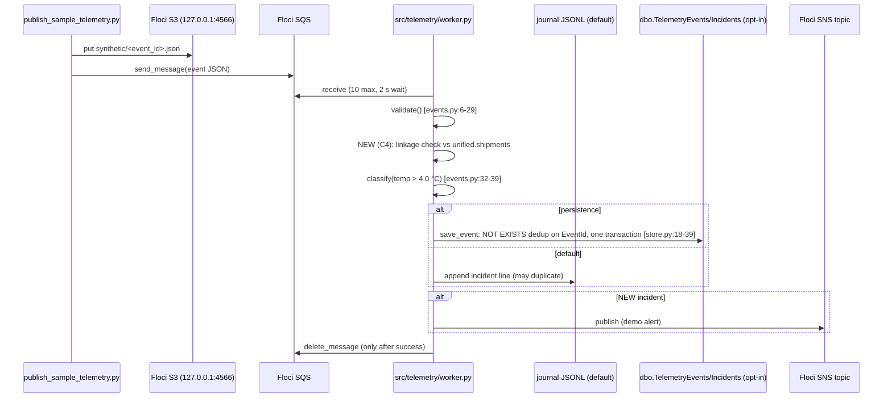
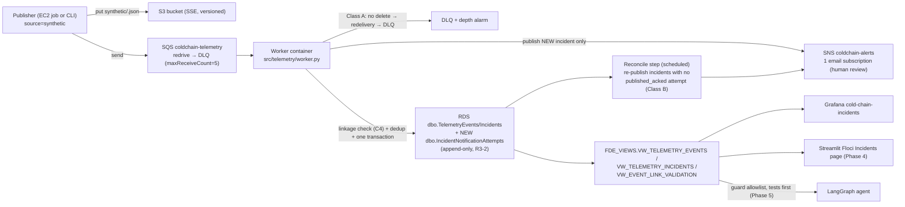

# 03 — Unified Dataset & Event Processing Design

Revision 5 (2026-11-03: SNS Standard retained — FIFO is not an email-
compatible path (R5-1); at-least-once duplicate semantics and database-only
reconciliation limitations stated honestly (R5-2)). Prior corrections
preserved: linkage C4/R3, append-only attempts R3-2/R4-3, reconciliation
mechanics B5, ack-vs-delivery B4.

## PART A — Canonical unified dataset (requirement 3)

### Current state (verified)

- One canonical dataset: `data/unified/` — 7 relational CSV tables + SQLite
  (22 MB, FK-clean, counts match `DATASET_MANIFEST.json` exactly;
  live-validated in this review) + SQL Server schema/import.
- Relational spine: everything keys on `shipment_id` → `shipments`;
  `telemetry` FKs to shipments/sensors/vehicles; `alerts`, `custody_handoffs`,
  `route_events` FK to shipments (and route_events→telemetry).
  Evidence: `data/unified/sqlite_schema.sql:9-109`.
- Approved agent interface: `FDE_VIEWS.VW_*` (7 views,
  `scripts/setup_unified_views.sql`), enforced additionally by
  `src/sql_guard.py` allowlist (`ALLOWED_VIEWS`, line 5).
- Manifest: seed 53026, dates 2021-01-01 → 2026-10-31, per-year shipment
  counts 730/730/730/493/827/510
  (`data/unified/DATASET_MANIFEST.json:27-35`).

### Target design

The dataset design is **preserved, not extended**. AWS deployment changes
where the data lives (RDS SQL Server), not its shape:

```mermaid
erDiagram
    vehicles ||--o{ shipments : "vehicle_id"
    shipments ||--o{ sensors : "shipment_id"
    shipments ||--o{ telemetry : "shipment_id"
    sensors ||--o{ telemetry : "sensor_id"
    vehicles ||--o{ telemetry : "vehicle_id"
    shipments ||--o{ custody_handoffs : "shipment_id"
    shipments ||--o{ alerts : "shipment_id"
    shipments ||--o{ route_events : "shipment_id"
    telemetry ||--o{ route_events : "telemetry_id"
    shipments {
        string shipment_id PK
        string cargo_type
        string vehicle_id FK
        string departed_at
        string receiver_verdict
        real temperature_min_c
        real temperature_max_c
    }
    telemetry {
        int telemetry_id PK
        string shipment_id FK
        string sensor_id FK
        string recorded_at
        real temperature_c
        real humidity_pct
        real traffic_congestion
        real fuel_consumption_l_per_100km
        real fuel_level_pct
    }
}
```

Consistency rules (all current, kept):

1. **One shipment key space**: unified IDs (`UC-xxxxxx`); Floci demo events
   must reference an existing unified shipment (`DEMO_SHIPMENT_ID`,
   `README.md:33` — default `UC-003241`).
2. **No cross-source identity invention** — system prompt forbids invented
   joins (`src/prompts/system_prompt.txt:4`); SQL guard physically forbids
   joins (`src/sql_guard.py:24-25`).
3. **Synthetic labeling is data, not UI**: `synthetic_test_data` and
   `source_category` columns exist in `shipments` and `telemetry`
   (`data/unified/sql_server_schema.sql:11-22,43-60`).
4. Import is FK-gated: `data/unified/import_sql_server.py:8-11` runs
   `PRAGMA foreign_key_check` before any SQL Server write.
5. Timestamps: TEXT/datetime2 with `TRY_CONVERT` at the view layer
   (`scripts/setup_unified_views.sql:5`) — the RDS import uses these files
   unchanged.

## PART B — Event processing (requirement 4)

### B1. Event → unified shipment linkage (correction C4)

Telemetry events (Floci local or AWS) link to the canonical dataset **by
shipment ID, validated at ingestion, without a foreign key** — the no-FK
separation is deliberate so demo/replay events can never masquerade as rows
of the historical dataset, while linkage remains enforceable and checkable:

| Aspect | Design | Evidence/status |
|---|---|---|
| Link key | `TelemetryEvents.ShipmentId` / `TelemetryIncidents.ShipmentId` store a unified `shipment_id` (e.g. `UC-003241`) | schema exists: `scripts/setup_telemetry.sql:8,21` |
| Linkage validation (ingest time) | Worker, before persisting, must confirm the shipment exists: `SELECT 1 FROM unified.shipments WHERE shipment_id = :sid`. Invalid linkage → event rejected into the DLQ (labeled `bad_shipment_ref`), never silently accepted | planned (Phase 4; `src/telemetry/worker.py` today does not check — current demo default `UC-003241` is chosen to exist, `README.md:33`) |
| Linkage validation (reporting) | New view `FDE_VIEWS.VW_EVENT_LINK_VALIDATION`: LEFT JOIN of `TelemetryEvents` to `unified.shipments` exposing any event whose ShipmentId has no unified shipment (`source`, `observed_at` columns only) | planned (Phase 4, applied by `sql-init` with the other scripts) |
| Event timestamp | `ObservedAtUtc` — when the reading claims to have happened (producer-set, ISO 8601 UTC; validated with timezone, `src/telemetry/events.py:14-22`) | implemented |
| Ingestion timestamp | `IngestedAtUtc` — server-set `SYSUTCDATETIME()` defaults, never client-supplied (`setup_telemetry.sql:12,27`; incidents `CreatedAtUtc:28`) | implemented in schema |
| Drift visibility | Grafana incident panel + the agent can cite the difference between observed and ingested times when describing replay/demo data | planned panel column (Phase 4) |
| Approved SQL views | `FDE_VIEWS.VW_TELEMETRY_EVENTS`, `VW_TELEMETRY_INCIDENTS` (`setup_telemetry.sql:33-39`) exposed as UTC `datetime2`; **agent access added only in Phase 5** via guard allowlist + docstring + tests together (gap G-EP-3) | views defined (unverified live); agent path planned |
| Visibility — Grafana | Incident dashboard `cold-chain-incidents` panels 1-3 read the two views, split by `Provenance` (`telemetry-incidents.json:30,52,74`) | designed; unverified live |
| Visibility — Streamlit | Planned: the Floci Incidents page, in MSSQL mode, lists recent incidents from `VW_TELEMETRY_INCIDENTS` (view-only UI identity) with an explicit "separate synthetic event stream" label | planned (Phase 4; today the page only link-outs, `src/ui.py:82-85`) |
| Visibility — LangGraph | `query_telemetry_db` allowlist extension to the two incident views (guard tests first — guidelines §5.3) | planned (Phase 5) |
| Synthetic vs historical distinction | Enforced at three layers: (1) separate tables (never appended to `unified.telemetry`); (2) `Provenance` CHECK constraint `('synthetic','real')` (`setup_telemetry.sql:11,25`); (3) UI/prompt labels (`src/ui.py:85`, `system_prompt.txt:1-2`). The agent must state whether an answer cites historical synthetic data or separately-ingested events | implemented in schema + prompts; live behavior gated by C13 |

### B2. Local (Floci) — current, implemented, test-verified offline



Verified by `tests/test_telemetry.py` and `tests/test_telemetry_store.py`
(20/21 suite passes on this machine; duplicate event → no second insert, no
SNS publish).

### B3. Two failure classes and their handling (correction C9)

A DLQ and a post-commit publish failure are **different failure classes**;
neither covers the other:

| | Class A — processing failure | Class B — post-commit notification failure |
|---|---|---|
| When | Before/at commit: invalid JSON, validation error, DB unreachable | **After** the incident row is committed, **before/while** SNS publish succeeds |
| SQS's view | Message not deleted (`worker.py:36-37`) → redelivery → after `maxReceiveCount` (5) → **DLQ** with CloudWatch alarm on DLQ depth | Message *was* processed successfully from SQS's perspective; redelivery alone cannot fix it — see the duplicate-suppression trap below |
| The trap | — | On redelivery, `save_event` returns `created=False` (duplicate) and the worker **skips SNS publish entirely** (`worker.py:31-33`) — the notification is lost silently, permanently. This is the exact gap `integrations/floci/README.md:19` acknowledges |
| Fix | SQS DLQ + redrive policy (planned, Phase 4) | **Append-only attempt model (R3-2)** — chosen so the worker needs **no UPDATE permission** (guidelines: "Do not grant UPDATE or DELETE to the automated worker", `scripts/setup_telemetry.sql:46`). New table `dbo.IncidentNotificationAttempts`: `AttemptId IDENTITY PK`, `IncidentId FK`, `AttemptedAtUtc DEFAULT SYSUTCDATETIME()`, `AttemptResult` (`published_acked` / `publish_failed`), `ErrorCode`, `SnsMessageId NULL`. The worker **INSERTs one attempt row per publish outcome** and never mutates anything. Delivery state is **derived by query** (an incident is "notified" iff it has ≥1 `published_acked` attempt); a scheduled reconcile step finds incidents with no `published_acked` attempt older than N minutes and re-publishes (each retry appends another attempt row). Reconciliation mechanics and guarantees: §B5 |
| Monitoring | DLQ-depth alarm | Reconcile-pending-age alarm (incidents undelivered > 30 min) |

AWS event pipeline:



Property table (updated):

| Requirement | Local (today) | AWS (target) |
|---|---|---|
| Provenance | `source` ∈ {synthetic, real} validated (`events.py:27-28`); DB CHECK; publisher hard-codes synthetic | Same; S3 key prefix `synthetic/`; provenance column in every view |
| Idempotency | `EventId` dedup transactionally (`store.py:23-29`); SNS only for new events | Unchanged (mandatory under at-least-once SQS) |
| Retries (Class A) | No delete on error → SQS redelivery (`worker.py:36-37`) | DLQ redrive (`maxReceiveCount=5`) + alarm |
| Reliability (Class B) | **Lost silently** (documented gap) | Append-only attempt rows + scheduled reconcile (B3, R3-2) — no UPDATE permission anywhere |
| Persistence | JSONL default; SQL opt-in | SQL always; JSONL only as local fallback |
| Linkage | Convention only (demo ID chosen to exist) | Ingest-time validation + validation view (B1) |
| Dashboard visibility | Grafana incident dashboard designed | Same + Streamlit page (B1) |
| Agent visibility | Not possible (allowlist excludes views) | Phase 5 with tests |
| Escalation honesty | SNS has no human endpoint | One email subscription = demo of delivery, not operational escalation (ADR-7) |

### B4. SNS acknowledgement vs recipient delivery (R3-2, part 2)

Two further distinctions the ledger must not blur:

1. **Publish acknowledgement**: a successful `sns.publish()` return only
   proves the SNS **topic accepted the message**. The attempt row therefore
   records `published_acked` — an SNS ack, **not** recipient delivery.
2. **Recipient delivery**: actual email delivery is observed **outside the
   application** via the topic's CloudWatch metrics
   (`NumberOfNotificationsDelivered`, `NumberOfNotificationsFailed`,
   `NumberOfNotificationsPending`) and per-subscription RED metrics; email
   is never individually receipt-confirmed by design. A
   `NumberOfNotificationsFailed` alarm (deployed with the queue module,
   Phase 4 — R3-8) is the delivery-failure signal, and a subscription left
   `PendingConfirmation` is a configuration alarm.

The Grafana incident dashboard and the audit trail therefore label the
ledger state as **"SNS-acked"**, never "delivered", when describing
notifications.

### B5. Reconciliation mechanics and delivery guarantees (R4-3)

**Simultaneous reconcilers — duplicate-publication avoidance and residual
risk (two prevention layers + one honestly-accepted window):**

1. **Single-scheduler construction**: exactly one reconcile job exists —
   scheduled on the one app host (SSM association / EventBridge → SSM
   RunCommand), single-threaded. There are no concurrent reconcilers by
   construction.
2. **SQL advisory lock (defense-in-depth)**: the reconcile step takes
   `sp_getapplock('coldchain_notify_reconcile')` for its duration; a second
   instance (e.g., a manually triggered run) acquires the lock with a 0 s
   timeout and exits immediately. This is an in-transaction advisory lock —
   not a data mutation, so the writer's INSERT-only permission still
   suffices for its own work; the lock call is executed in the same session.
3. **Residual risk — at-least-once, not detectable from the database (R5-2):**
   AWS SNS Standard topics are at-least-once, and the reconcile path has a
   **crash window between SNS acknowledging a publication and the attempt
   row being inserted**. A crash inside that window leaves a *successfully
   published* message with **no attempt record**. Consequences, stated
   explicitly: **possible duplicate emails** (reconcile sees zero
   `published_acked` rows and re-publishes an already-published incident)
   and **possible missing attempt records** (publications the database does
   not know about). The attempt table therefore makes *most* duplicates
   visible, but **not all** — a duplicate whose first publication lost its
   attempt row appears in the database as a single legitimate attempt.
   This is a limitation of **database-only notification reconciliation**:
   it cannot distinguish "never published" from "published but
   acknowledgement unrecorded"; the topic's CloudWatch metrics are the only
   cross-check (a `NumberOfNotificationsDelivered` count exceeding the
   database's acked-attempt count is the tell-tale of lost attempt rows).
   Duplicate demo emails are tolerated and flagged for review.
   *SNS FIFO is NOT a drop-in remedy (R5-1): FIFO topics do not support
   direct email subscriptions. The test environment therefore stays on SNS
   Standard. If deduplication is ever required, FIFO adoption means a
   materially different pipeline — a FIFO-compatible downstream consumer
   (e.g., an SQS FIFO subscription with `MessageDeduplicationId =
   IncidentId`) followed by a **separate email delivery mechanism** reading
   that queue (e.g., a small worker/SES sender) — deferred, not chosen.*

**Bounded retries (derived, never mutated):**

| Parameter | Default | Meaning |
|---|---|---|
| `NOTIFY_MAX_ATTEMPTS` | 5 | reconcile re-publishes only while `attempt_count(incident) < 5` |
| `NOTIFY_ATTEMPT_WINDOW_H` | 24 | attempts counted within a 24 h window from the incident's first attempt |
| Reconcile interval | 15 min | effective backoff: 15 m → 30 m → 1 h → 2 h → 4 h (next eligible time = last attempt + interval × 2^(attempts−1), capped at 4 h) |
| Exhaustion | — | an incident with `MAX_ATTEMPTS` reached and still no `published_acked` ⇒ **reconcile-exhausted alarm** (fires with the undelivered-age alarm); no further automatic attempts |

**How failed vs acknowledged publications are identified:**

- `published_acked`: `sns.publish()` returned a 2xx **and** a `MessageId`;
  the `MessageId` is stored in the attempt row (`SnsMessageId`), proving
  topic acceptance and enabling cross-reference against the topic's
  CloudWatch metrics.
- `publish_failed`: `sns.publish()` raised (throttle, validation, IAM) —
  `ErrorCode` stores a short class (`sns_throttled`, `sns_invalid_param`,
  `sns_access_denied`); raw exception payloads are not stored.
- "Notified" (derived) = ≥ 1 `published_acked` row. Anything else is
  unnotified/pending/exhausted — derived, never a mutable status column.

**Delivery guarantees — what is and is not achievable:**

| Achievable | NOT achievable |
|---|---|
| at-least-once publish to the topic, with bounded, visible retries | exactly-once end-to-end (Standard SNS is at-least-once; duplicates possible) |
| guaranteed *detection of publish failures* (attempt rows + alarms) | per-recipient delivery confirmation (email has no per-message receipt; only topic-level CW metrics) |
| visibility of **most** duplicates in the attempt table | visibility of **all** duplicates (R5-2: the ack→insert crash window can leave a published message with no attempt record — a database-only reconciliation cannot detect it) |
| cross-checking lost attempt rows via topic CW metrics (delivered count vs acked count) | zero duplicate emails (crash window above; a FIFO pipeline would need an SQS FIFO consumer + separate email mechanism — a different architecture, not chosen) |
| fail-closed silence after retry exhaustion, with alarm | delivery SLA enforcement (no outbox/queue between publish and subscription) |

**Note on full outbox**: the append-only attempt model is deliberately
scoped to the publish step (the only post-commit side effect). A complete
transactional-outbox eventing system remains deferred unless alerts become
operational (ADR-7).