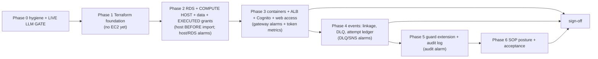

# 09 — Implementation Roadmap (requirement 10)

Revision 4 (2026-11-03: Cognito client-secret + authorization corrections
applied R4-1/R4-2; Phase 3 gains a measured load test R4-4; Phase 4 gains
reconciliation mechanics R4-3). Prior revisions preserved: host provisioned
before import R3-1; controls co-deployed per phase R3-8; live-LLM gate at
Phase 0 C13.

**Nothing below is executed yet** — this plan is submitted for final audit.
Guiding rule from `GLM_5_3_PROJECT_GUIDELINES.md` §10: when data or
interfaces change, generator/importer/views/guard/prompt/UI/Grafana/tests/docs
move **together**.

## Phase 0 — Hygiene + live LLM gate (no infrastructure) — ✅ COMPLETE 2026-11-15 (C13 closed, ledger R6-3; originally the Ollama Cloud gate, re-targeted to NIM by R6-1)

| Touches | Work |
|---|---|
| `tests/test_llm_provider.py` | add `encoding="utf-8"` to both `read_text()` calls (G-HY-1) |
| `.env.streamlit-embed.example` | fix stale `fleet-history` URL → unified dashboard (G-HY-2) |
| `.env` (operator-local, never committed) | 🆕 R6-1 (2026-11-08): `NVIDIA_API_KEY` configured; `python scripts/check_nim.py` executed with evidence |
| runbook `docs/evidence/` | **Live tool-calling gate (C13)** — 🆕 re-targeted to NIM by R6-1: one real gateway conversation that must invoke `fetch_corridor_conditions` and cite its output. The NIM API-level loop is already live-verified (2026-11-03, 10/10, `architecture-review/NVIDIA_NIM_API_VERIFICATION.md`); the remaining piece is one conversation through THIS gateway. U-6 is resolved by the same evidence: NIM returns a `usage` object with reasoning-token breakdown on every response (C12 token counter implemented in `api/main.py` at R6-1) — **✅ CLOSED 2026-11-15 (ledger R6-3)**: executed and operator-ratified; evidence `docs/evidence/C13_LIVE_GATEWAY_VERIFICATION.md` (HTTP 200 in 95.0 s; guard enforced, zero SECURITY BLOCKs, no leaks; the weather citation is represented by its validated failure path per C13-F2 — api.open-meteo.com was network-blocked at test time; successful citation to be re-run opportunistically once reachable). The application is functional per this gate |

- **Depends on**: nothing. **Acceptance**: `pytest -q tests` green on Windows
  AND Ubuntu; live tool-call transcript archived. **The application is NOT
  declared functional before this gate.**
- **Rollback**: git revert. **Tests**: existing suite + archived live evidence.

## Phase 1 — Terraform foundation (network, state, IAM, secrets containers, pipelines, billing alarm)

| Creates | Work |
|---|---|
| `infra/backend.hcl.example`, `infra/environments/{dev,prod}/` | S3 backend with **`use_lockfile = true`** (C2), versioning, SSE-KMS, separate state keys + IAM boundaries |
| `infra/modules/{network,secrets,observability,oidc}/` | Chosen topology (C1) with the **exact SG/route rules of `01` §3.1** (R3-4); empty secret containers only (C8); log groups; **billing alarm at 120% of the `07` estimate — deployed here, first (R3-8)** |
| `.github/workflows/` | Split pipelines (C6): `deploy.yml` (validate) + `build-images.yml` (push `sha-<tag>`) + `infra.yml` (plan on PR; apply via dispatch + `infra-approval`) + `release.yml` (dispatch + `release-approval`) |

- **Depends on**: Phase 0. **Acceptance**: `terraform validate`/`plan` clean
  in CI; parallel-plan lock conflict test passes; **no EC2 instance exists
  yet in this phase** (the "public IPv4 only for egress" question cannot
  arise here — see R3-4 fix); billing alarm exists and fires on a synthetic
  threshold breach; **current AWS Pricing Calculator export for the selected
  region attached to the approval record (hard precondition for
  provisioning — R4-4)**.
- **Rollback**: git revert + forward `terraform apply`; targeted
  `terraform destroy` — **never** state-file overwrites (§Rollback doctrine).
- **Tests**: CI plan runs; state-lock integration check.

## Phase 2 — RDS + compute host (provisioned FIRST) + canonical data + EXECUTED grants

> **R3-1 sequencing fix:** the EC2 host is provisioned **in this phase** —
> before any SSM-driven import — because Phase 2's `sql-init` and
> `data-import` steps execute on it. Phase 3 only *adds* web access and
> application containers to the existing host. No temporary import runner is
> needed; the host created here is the same one production uses.

| Touches | Work |
|---|---|
| `infra/modules/compute/` (host part) | EC2 app host + instance profile + EBS + SSM agent + Docker — **provisioned now, with zero application containers and no ALB**: inbound SG is empty (SSM is outbound-initiated; no SSH rule exists) |
| `infra/modules/rds/` | RDS Express dev tier (Standard path — ADR-3) in data subnets, `publicly_accessible=false` |
| `infra/modules/{sql-init,data-import}/` | SSM RunCommand **on the just-provisioned host**: apply schema + views + telemetry tables + **EXECUTED** identity/grant block + `verify_grants.sql` (C5, C7); run `scripts/import_unified.py` (FK pre-check built in) |
| `infra/modules/observability/` | **Host alarms now (R3-8)**: CPU credit balance, disk, memory (CW agent); **RDS alarms now**: CPU, storage, connections. RDS/host compute is what these protect, so they deploy with them |
| `tests/` | grant-assertion query checked in |

- **Depends on**: Phase 1. **Acceptance**: host reachable via SSM and NOT
  reachable from the internet (external port scan of the host's public IPv4
  shows zero open ports — R3-4 gate); import completed with manifest-exact
  counts; `verify_grants.sql` shows the exact matrix of `05_SECURITY_MODEL.md`
  §3 and zero application grants on `unified.*`; host/RDS/billing alarms
  exist in CloudWatch.
- **Rollback**: destroy RDS module (final snapshot retained); destroy host;
  data re-importable from repo CSVs. **Tests**: count query vs manifest;
  permission query; external port-scan record; alarm presence check.

## Phase 3 — Application services + web access (ALB, Cognito, containers)

| Touches | Work |
|---|---|
| `infra/modules/alb/` + `infra/modules/cognito/` | ALB HTTPS + host routing + **ALB authenticate-cognito** for Streamlit (IdP fully specified `01` §7.1 — R3-5); ACM cert; HSTS; 80→443 |
| `deploy/docker-compose.aws.yml` | Containers on the existing host: fastapi (compose-network only), streamlit, grafana (`USR_GRAFANA_RO`), librechat, mongodb (cache capped `--wiredTigerCacheSizeGB 0.5`), worker — **with the memory limits of `01` §9 capacity budget (R3-6)** |
| `integrations/grafana/provisioning/datasources/mssql.yml` | datasource user → `USR_GRAFANA_RO` (G-SEC-2) |
| `infra/modules/observability/` | **Gateway alarms + token metrics now (R3-8)**: 5xx rate, latency, `ColdChain/NimTokens` metric emission (renamed by R6-1; feasibility confirmed at Phase 0 gate, U-6 resolved) |
| `api/main.py` (usage log hook) | structured per-request token line (C12) |
| smoke | health/models via SSM tunnel; Grafana panels render; LibreChat login; **live SQL tool-call**; secrets no-leak grep (`01` §5.6); browser CSP/console checks on all three iframes |

- **Depends on**: Phase 2 (host + data + grants). **Acceptance**: smoke green;
  Cognito login gates Streamlit (client with `generate_secret = true`,
  authorization-code grant, R4-1) and unauthenticated access to `app.*` is
  redirected; **authorization posture demonstrated exactly as designed
  (R4-2): every authenticated pool user reaches Streamlit — and no
  group-based claim is tested, because none is claimed**; embedded services
  keep own logins; **measured load test executed and archived (R4-4):
  concurrent operator session drill within the `01` §9 limits — capacity
  declared adequate only from this evidence**; `docker stats` within budget;
  no container exceeds its limit under the drill; secrets no-leak grep
  includes the Cognito client secret value.
- **Rollback**: re-run `release.yml` with previous `sha-<tag>`; ALB removed
  without data impact. **Tests**: smoke workflow; alarm drill on 502;
  load-test report archived in `docs/evidence/`.

## Phase 4 — Event pipeline on AWS (linkage, DLQ, append-only attempt ledger)

| Touches | Work |
|---|---|
| `infra/modules/{queue,storage}/` | bucket, SQS + DLQ (redrive `maxReceiveCount=5`), SNS + one email subscription, **DLQ-depth + reconcile-pending-age + SNS delivery-failure alarms now (R3-8)** |
| `src/telemetry/worker.py`, `store.py` | **Application changes**: ingest-time shipment-linkage validation (C4); **append-only notification-attempt rows** (`dbo.IncidentNotificationAttempts`, INSERT-only — R3-2; no UPDATE permission anywhere) + scheduled reconcile step |
| `scripts/setup_telemetry.sql` | add `dbo.IncidentNotificationAttempts` + `FDE_VIEWS.VW_EVENT_LINK_VALIDATION` (applied via `sql-init` on the host) |
| `src/ui.py` | Floci Incidents page lists incidents from `VW_TELEMETRY_INCIDENTS` (C4 visibility) |

- **Depends on**: Phase 3. **Acceptance**: published event → S3 → SQS → worker
  → rows + (if >4.0 °C) incident → SNS email received; **duplicate event ID →
  zero new rows, zero new SNS**; **unknown shipment_id → DLQ labeled
  `bad_shipment_ref`**; poison message → DLQ after 5 receives + alarm;
  kill-publish drill → a NEW attempt row is appended and the reconcile step
  re-publishes within one cycle (state derived by query, not mutated — R3-2);
  **reconciliation mechanics verified per R4-3/R5 (`03` §B5): concurrent
  reconcile trigger takes the advisory lock and the second exits without
  publishing; attempts stop at `NOTIFY_MAX_ATTEMPTS` (exhaustion alarm
  fires); acked rows carry `SnsMessageId`; the at-least-once behavior is
  accepted as designed — duplicate emails and missing attempt records are
  possible in the ack→insert crash window and are NOT claimed to be
  database-detectable (topic CW metrics are the cross-check)**;
  `NumberOfNotificationsDelivered`/`Failed` CW metrics visible (SNS ack ≠
  recipient delivery — `03` §B4).
- **Rollback**: drain queue + stop worker; destroy queue module; incident
  tables retained. **Tests**: extended `tests/test_telemetry*.py` (linkage,
  attempt-append idempotency, bounded-retry derivation); end-to-end drill
  script.

## Phase 5 — Security hardening: incident-view agent access + minimized audit log

| Touches | Work |
|---|---|
| `src/sql_guard.py`, `src/agent_tools.py` docstring, `tests/test_sql_guard.py` | allowlist `VW_TELEMETRY_EVENTS` / `VW_TELEMETRY_INCIDENTS` + threat tests **in one change** (G-EP-3, ADR-9) |
| `api/main.py` + `src/audit.py` + `dbo.AgentAuditLog` | data-minimized audit log (C10, `05` §5): hashes + previews + metadata only; INSERT-only writer; scrubber; 90-day purge |
| `scripts/setup_telemetry.sql` | audit table + `USR_AUDIT_WRITER` grant (executed via `sql-init`) |

- **Depends on**: Phase 4. **Acceptance**: guard allows exactly the extended
  view set; every chat request → one audit row with no raw prompt/output/
  credential retention (planted-fake-key scrubber test); audit-log row-count
  alarm present (R3-8 — audit log ships with its own alarm).
- **Rollback**: revert guard/audit commit together. **Tests**: `pytest`;
  SQL permission probe runbook.

## Phase 6 — SOP retrieval live ingest + final acceptance

| Touches | Work |
|---|---|
| `scripts/ingest_sop_pinecone.py` | configurable workflow (C11) + metadata enrichment (`sop_version`, `effective_date`, `applicability`); **AWS retrieval posture decision applied (U-9 — see `01` §9)**: OPENAI query-time embeddings (recommended, no local model in gateway) or LOCAL (requires the larger instance per the capacity budget) |
| runbook | one-time Pinecone ingest; live `search_compliance_sop` through the agent with version/applicability citations |

- **Depends on**: Phase 5. **Acceptance**: agent cites SOP v2.4 with
  applicability; retrieval memory footprint matches the chosen posture's
  budget line. **Rollback**: re-ingest from hash cache. **Tests**: manual
  scripted conversation; evidence archived.

## Phase 7 — Consolidated observability, drills, and cost review

| Touches | Work |
|---|---|
| `infra/modules/observability/` | Cross-service dashboards over the per-phase alarms (all alarms already exist since their services' phases — R3-8); fault-drill suite: gateway kill, worker stop, DLQ poison, publish-kill, alarm-breach; monthly cost-vs-estimate review runbook |

- **Depends on**: Phases 3–6. **Acceptance**: every alarm fires in its drill;
  one week of token metrics reconciled against the NIM usage evidence (NIM has
  no credit API or spending dashboard — F-4; the gateway's token accounting is
  the application-side record); actual
  AWS bill within ±20% of the `07` estimate (else re-estimate).
- **Rollback**: alarm deletes via Terraform. **Tests**: fault-drill checklist.

## Dependency graph (R3-1 corrected)

## Rollback doctrine (C14 — unchanged, applies to ALL phases)

1. **Never edit, overwrite, or restore Terraform state as a rollback
   mechanism** (S3 versioning = break-glass corrupted-state recovery only,
   with lock + incident record + forward apply).
2. Infrastructure rollback = git revert → `terraform apply` (forward), or
   targeted `terraform destroy`.
3. Data rollback = RDS PITR / final snapshots.
4. Application rollback = `release.yml` with the previous `sha-<tag>`.
5. Global survival guarantee: destroy all AWS resources → the application
   still runs offline on SQLite.

## Global rules across all phases

1. One PR set per phase including its tests; `deploy.yml` validation stays
   green throughout.
2. No `terraform apply` without environment approval; no real AWS resource
   before blueprint approval.
3. Every phase updates `.env.example`, `docs/INSTALLATION.md`, and the
   relevant integration README in the same PR (guidelines §4 step 5).
4. Application code changes are limited to the exact files listed above.
5. **Every service deploys with its own observability and security controls
   in the same phase (R3-8)** — Phase 7 only consolidates and drills.