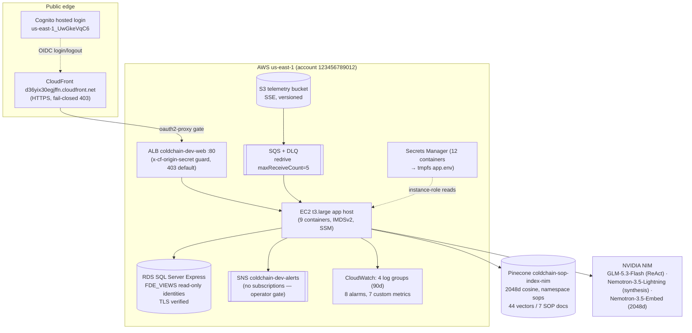
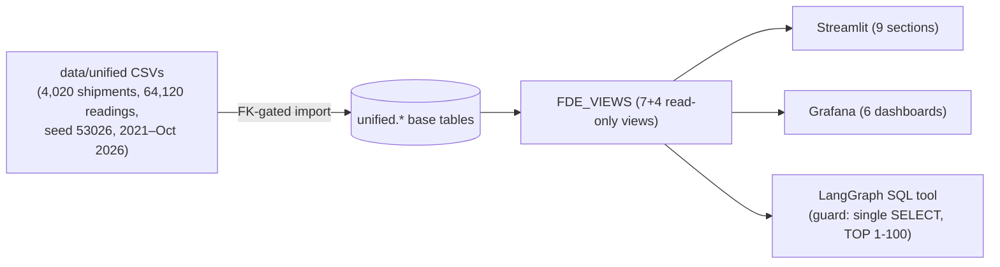
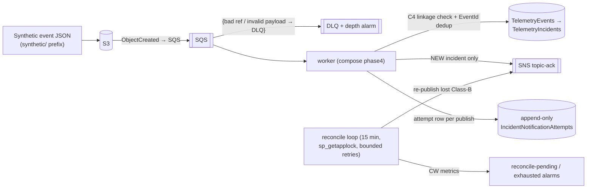
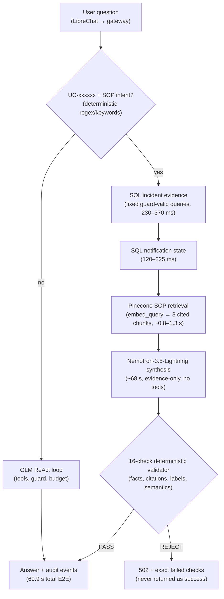
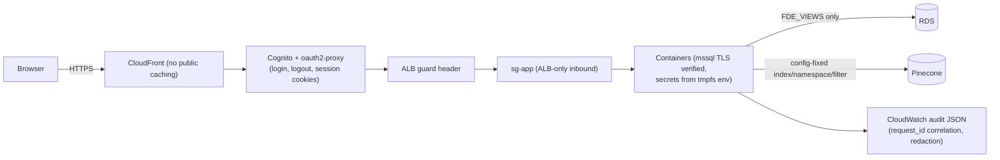

# Architecture Diagrams — Cold-Chain Logistics AI Agent (2026-11-18)

All diagrams reflect the DEPLOYED configuration (Phases 0–6 complete).

## 1. System architecture

## 2. Data flow (synthetic dataset → consumption)

## 3. Incident processing (Phase 4 event plane)

## 4. AI retrieval workflow (Phase 6 final form)

## 5. Security architecture (layers)

